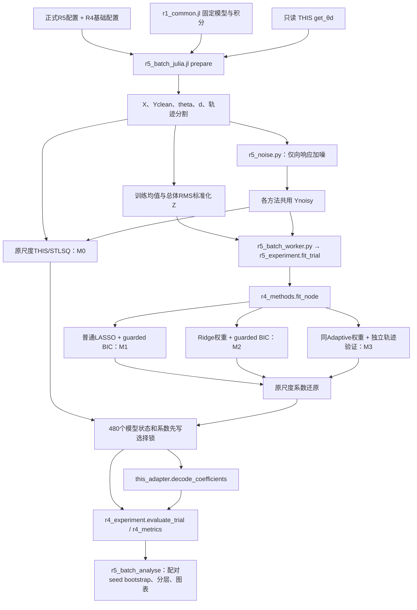

# S0：实际目录、实现位置与依赖图

盘点日期：2026-10-19，Asia/Shanghai。根目录：`/home/yg/THIS-Lasso`。
依据用户提供的 `Codex_THIS_Refactor_Plan/00_START_HERE.md`、`01_S0_Inventory.md`；只读分析现有文件，仅新增 `docs/refactor/S0_*.md/csv`。本文件中的目标路径均为后续建议，未创建相应模块、移动文件或修改算法。

## 1. 实际目录

以下为有限深度目录树；重复的 seed/noise/method 目录压缩展示，逐文件及符号链接清单见 [S0_inventory.csv](S0_inventory.csv)。缓存目录在此折叠，但 CSV 未遗漏其文件。所有路径相对于项目根目录。

```text
THIS-Lasso/                         # 根目录不是 Git 仓库
├── .gitignore                     # 忽略 upstream、两个环境、Python 缓存
├── .vscode/settings.json
├── .venv-r0/                      # 实际是 Conda prefix，不是 Python venv
├── .julia-depot-r0/
├── README.md                      # 当前进度说明停在 R2，已过期
├── Codex_THIS_Refactor_Plan/       # 新任务包，8 份 Markdown
├── codex任务文件夹/               # 原 R0–R5 任务，9 份 Markdown
├── upstream/
│   ├── THIS/                      # 独立 Git 仓库，.git 保留
│   └── Su-AdaptiveLASSO/           # 独立 Git 仓库，.git 保留
├── environment/r0/
│   ├── activate.sh / julia.sh
│   ├── requirements.in / requirements.lock.txt
│   ├── conda-linux-64.lock.txt / upstream_lock.json / README.md
│   └── julia/Project.toml / Manifest.toml
├── src/
│   ├── this_adapter.jl
│   ├── data_bridge.py
│   └── solvers/__init__.py / adaptive_lasso.py
├── scripts/                       # 37 个文件，仍存在跨阶段公共实现
├── configs/                       # 4 份，正式/smoke/中止协议不能混用
├── tests/                         # 5 个 Python 测试文件、3 个 Julia 测试文件
├── data/r1/                       # 原始基准及 revision 固定数据，共18个文件
├── results/
│   ├── r1/                        # 含 revision、history.log 和原基准证据
│   ├── r3/                        # stlsq/lasso/adaptive_lasso、review、logs
│   ├── r4/dry_run/                # 两 seed、六方法，R4 B 尚未执行
│   ├── r4/logs/
│   └── r5/
│       ├── e1_smoke/              # 两 seed 先导验证
│       ├── e1_full/               # 中止批次，绝不能混入正式统计
│       ├── e1_full_independent/   # 唯一正式30-seed结果
│       │   ├── clean/seed_*/data/
│       │   ├── seed_*/noise_*/data/ 和 M0/…/M3/
│       │   ├── logs/ / history/ / figures/
│       │   └── 协议、选择锁、指标、诊断、审计和manifest
│       ├── logs/                 # 正式、smoke、中止日志均有用途
│       └── artifact_manifest.toml 等阶段级证据
├── reports/                       # R0–R5 报告与学习笔记、r0_logs
└── docs/                          # 原有3份说明；本轮新增 refactor/S0_* 审计
```

不存在 `results/r2/` 不属于缺失：R2 演示与验证证据保存在当前报告、既有 R1 审计记录等实际位置；不能为了匹配阶段名称补造目录。`experiments/`、`archive/` 及任务包建议的模块目录尚未创建。

## 2. 论文源码与只读界限

| 原仓库 | 实际位置 | 当前 commit | 检查结果 |
| --- | --- | --- | --- |
| THIS | `upstream/THIS/` | `865efc43fe8ec21966659b482ca5756396974425` | Git status 空；9 个跟踪文件与 R0 哈希一致 |
| Adaptive LASSO 高阶振荡系统 | `upstream/Su-AdaptiveLASSO/` | `fa0d662f68b7b41a1c6c3401af9504929126dafd` | Git status 空；109 个跟踪文件与 R0 哈希一致 |

来源分别为 `https://github.com/TaylorBasedHypergraphInference/THIS.git`、`https://github.com/Weiwei-Su112/Adaptive-LASSO-for-higher-order-oscillatory-systems.git`；许可证为 GPL-3.0、MIT，以各原仓库 LICENSE 为准。它们是保有独立 `.git` 的本地 clone/vendor 目录，不是已注册于父仓库的 submodule：项目根目录没有 Git 仓库。未访问远程、未 fetch 或更新源码。

两目录整体保持原样，包括原作者数据、`.DS_Store`、LICENSE、README、Git 元数据。只读是本轮及后续重构边界，本轮没有用 chmod 改变权限。来源/哈希记录在 `environment/r0/upstream_lock.json`。既有重复的旧下载副本删除记录仅是 R0 历史事实，本轮未执行清理。

THIS 的 Taylor、STLSQ 在正式运行中实际被调用。Su 的 `GeneralInteraction.py` 是原论文方法参照和 R0 smoke 导入对象；当前正式 M2/M3 调用自有 `src/solvers/adaptive_lasso.py`，不能声称直接调用 Su 原函数。Su 中 `solve_lasso`、`solve_lasso_one_node`、`solve_ada_lasso`、`solve_ada_lasso_one_node` 保留原振荡系统字典、初始化和截距语义，不能与 Taylor 求解器直接合并。

## 3. R0–R5 实际入口

| 阶段 | 入口/复查脚本 | 关键依赖与注意事项 |
| --- | --- | --- |
| R0 | `scripts/r0_run_logged.py`、`smoke_r0.py`、`smoke_r0.jl` | `environment/r0/`、两原论文源码；logger 会写日志 |
| R1 | `scripts/r1_run.jl` → `r1_baseline.jl`、`r1_replay.jl`；修订版 `r1_revision.jl`、`r1_revision_replay.jl` | `r1_common.jl`、`r1_revision_common.jl`、THIS；replay 也不能仅凭名字视为无副作用 |
| R2 | `scripts/r2_solver_demo.py`、`tests/test_r2_adaptive_lasso.py` | 自有 solver、只读 R1 revision；没有独立 results/r2 目录 |
| R3 | `scripts/r3_run.py` → `r3_demo.jl` / 测试 / `r3_audit.py`；专项 `r3_checklist.jl` | `src/this_adapter.jl`、`scripts/r3_bridge.py` → `src/data_bridge.py`；CSV/TOML 契约 |
| R4 A | `scripts/r4_run.py` → `r4_experiment.py` → `r4_prepare.jl` / Python / `r4_decode.jl` | `configs/r4_dry_run.toml`；M0/M0s/M1/M2/M3/M1v；B 未执行 |
| R5 smoke | `scripts/r5_run.py` → `r5_experiment.py`、`r5_stlsq.jl`、`r5_decode.jl` | `configs/r5_e1_smoke.toml`；只允许两 seed 的 guard 是有意边界 |
| R5 正式 | `scripts/r5_batch_log.py` → `r5_batch.py` → `r5_batch_julia.jl` / `r5_batch_worker.py` / `r5_batch_analyse.py` | `configs/r5_e1_full_independent.toml` 再引用 R4 基础配置；正式输出已有，不能原路径重跑 |
| R5 复核 | `scripts/r5_batch_audit.py`、`r5_check_independent_trajectories.py` | 两者都写回正式结果；S0 只读其代码和既有产物，未运行 |

`configs/r5_e1_full.toml` 对应中止批次，名称虽像 full，不是当前正式配置。`r5_run.py` 与 `r5_batch_log.py` 不是可随意互换的重复入口。

## 4. 正式 E1 核心数据流



图中是实际计算依赖，不表示所有模块均直接相互 import；Julia 通过子进程执行。原始真实结构只进入锁定后的结构评分/诊断，不参与 alpha 或权重选择。

## 5. 数学与接口的实际实现位置

| 功能 | 当前实际实现 | 必须保留的行为 |
| --- | --- | --- |
| 固定模型、解析导数、轨迹积分 | `scripts/r1_common.jl`：`make_model`、`rhs`、`simulate_trajectory`、`generate_dataset` | 原模型、真值、积分时间和 RNG 语义；修订基准另在 `r1_revision_common.jl` |
| 正式 trial 独立初值 | `scripts/r5_batch_julia.jl` prepare；Python 对应检查 `r5_batch_stats.trajectory_seed_base` | trial k 使用 `1000000000+k*10000`，160 个轨迹 seed 不重叠；不能改回连续 trial seed+轨迹编号 |
| Taylor 特征与 monomial indices | `upstream/THIS/this-tools.jl:get_θd`，从 `this.jl` include | 特征值、递归顺序、零填充、1-based 节点 ID；不移植重写 |
| 公共外部标准化 | `scripts/r4_prepare.jl:prepare` 与 `scripts/r5_batch_julia.jl:main(prepare)` | 仅训练 theta 的均值、中心化总体 RMS；首常量列均值0、尺度1；Z=(theta−mu)/s |
| Solver 内部中心化/尺度 | `src/solvers/adaptive_lasso.py:_prepare` | 独立公共 solver 允许内部标准化；R4/R5 在外部标准化后设置 `standardize=false`，不能再次缩放 |
| 普通 LASSO 固定/验证模式 | `src/data_bridge.py:fit_plain_lasso` | leading constant 吸收无惩罚偏置；验证网格、并列选较大 alpha、KKT 和警告规则 |
| 普通 LASSO+BIC | `scripts/r4_methods.py:fit_plain_bic` | LassoLarsIC；复用 `_prepare`、`_bic_variance`，不是普通验证 solver 的 bic 分支 |
| Adaptive LASSO | `src/solvers/adaptive_lasso.py:fit_adaptive_lasso` | Ridge(svd)训练初值，w=(abs(beta_init)+eps)^(-gamma)，U=(X_active−mu)/w，beta=theta/w；原单位目标和偏置保持 |
| guarded BIC | 同 solver `_bic_variance`、`_select`；普通路径在 `r4_methods.py` | 样本数、秩、条件数、全模型残差方差门槛；零噪声 NA，不偷偷 fallback |
| 独立验证选参 | 同 solver `_validation`、`_select`；普通版 `fit_plain_lasso` | train/validation 轨迹互斥由桥接/实验加载/Adaptive guard 分层保证；保留12点 alpha、容差、警告语义 |
| 原始 STLSQ | `upstream/THIS/this.jl:mySINDy`、`this` | λ=0.1、ρ=1、niter=10；原程序也惩罚常量，与 LASSO 不完全相同 |
| 原尺度系数还原 | `scripts/r4_metrics.py:restore_coefficients`；M0s 在 `r4_prepare.jl` 中的 Julia 版 | beta_raw=beta_z/s；bias_raw=bias_z−sum(mu*beta_raw)，验证预测一致 |
| 高阶解码 | 原生 `upstream/THIS/this.jl:this`；自有 `src/this_adapter.jl:decode_coefficients` | 重复源排除、目标不得在源内、严格 abs(C)>1e−8；原生返回1:4阶，仅评价2/3阶 |
| 边分数和结构指标 | `scripts/r4_metrics.py:edge_scores`、`binary_metrics` | 同一合法目标/源集合绝对系数最大值；候选全集零分保留；AP=average_precision_score |
| 逐 trial 评分与预测误差 | `scripts/r4_experiment.py:evaluate_trial`，R5 `r5_batch.py:evaluate_all` | 锁后评分；保留噪声/干净响应两种 MSE；NA 不补0 |
| 噪声/弱中强分层 | `scripts/r5_noise.py`、`r5_experiment.py:strength_rows` | sigma 仅干净训练响应；响应标准差比例而非方差；真实强度分组固定 |
| bootstrap、配对差值 | `scripts/r5_batch_stats.py`、`r5_batch_analyse.py` | 同 seed 配对，10000 seed-cluster bootstrap，逐点95%区间，有限样本分母，不调阈值 |
| CSV/TOML 与精度 | `src/data_bridge.py`、`src/this_adapter.jl`，R1 独立 I/O 也被复用 | 矩阵17位有效数字、输入哈希、响应契约、无陈旧覆盖；序列化不能随意换库 |

Julia 输入 X/Y 为 `[N,K]`、theta `[P,K]`、d `[P,3]`；Python 回归输入为 theta 或 Z 的转置 `[K,P]`，系数统一 `[N,P]`。N=8、P=165、K总480；训练/验证/测试为300/90/90。d 保留 Julia 1-based 节点和0填充，Python 数组位置0-based，不能整体对 d 减1。

R3 适配器的 STLSQ 分支还会比较原生与自有解码完全一致。R4/R5 Python worker 直接调用 fit_node，未绕经完整 R3 request/response 工作目录；但仍使用相同数值 I/O 和 Julia 解码，不能把两条运行路径混为一谈。

## 6. 六种方法的身份与配置

| 方法 | 实现入口 | 当前产物 | 不可合并抹平的差异 |
| --- | --- | --- | --- |
| M0 | `r4_prepare.jl` 或 `r5_batch_julia.jl` → `run_this_solver(stlsq)` → 原生 THIS | R4 A、R5 smoke/full | 原尺度，官方默认，惩罚常量 |
| M0s | `r4_prepare.jl` → 原生 `mySINDy(Z,Y)` → 原尺度还原 | R4 A | 公共标准化对照；非已废弃方法，正式 R5 未跑它 |
| M1 | `r4_methods.fit_node` → `fit_plain_bic` | R4 A、R5 smoke/full | 普通 LASSO+BIC；0噪声为 NA |
| M1v | `r4_methods.fit_node` → `src.data_bridge.fit_plain_lasso(validation)` | R4 A | 与 M3 比较选择策略的普通 LASSO 对照；正式 R5 未跑它 |
| M2 | `fit_node` → `fit_adaptive_lasso(selection=bic)` | R4 A、R5 smoke/full | 自适应+BIC；0噪声 NA |
| M3 | `fit_node` → `fit_adaptive_lasso(selection=validation)` | R4 A、R5 smoke/full | 含噪独立轨迹验证；保留未选中候选警告 |

六方法由 `configs/r4_dry_run.toml` 定义；正式 R5 配置只选择 M0/M1/M2/M3，并读取 R4 参数。R4 B、E2/E3 尚未执行，不应补造完成状态或删去其未来所需对照。

## 7. 建议合并位置：仅提案

CSV 中10个“建议合并”是来源文件数量，表示提取部分职责，绝非批准整文件删除。`src/solvers/adaptive_lasso.py` 和 `src/this_adapter.jl` 作为核心先保留原位，通过兼容包装逐步使用公共组件。

| 目标候选位置 | 来源 | 范围与保留方式 |
| --- | --- | --- |
| `src/solvers/plain_lasso.py` | `src/data_bridge.py:fit_plain_lasso`、`scripts/r4_methods.py:fit_plain_bic` | 普通求解器从 I/O 解耦；固定/验证/BIC身份明确，旧 import 先保持 |
| `src/selection/l1_selection.py` | Adaptive `_bic_variance/_select` 与普通版重复路径 | 先冻结 BIC/验证/并列规则，再提取确实等价的小函数；不强制所有求解器共用完全同一流程 |
| `src/preprocessing/taylor_scaling.jl`、Python 对应还原小模块 | R4/R5 prepare 与 `r4_metrics.restore_coefficients` | 仅提取自有标准化/还原；不改 upstream Taylor，不在两个语言间强行合为一个实现 |
| `src/bridge/` 的 Python/Julia 小模块 | `data_bridge.py`、`this_adapter.jl`、`r1_common.jl` 的数值 I/O | 分离序列化和求解，保持原文件API；TOML输出字节/类型差异需 golden 约束 |
| `src/metrics/structure.py`、`src/experiments/common.py` | `r4_metrics.py`、`r4_experiment.py` | 前者只集中当前边评分/还原，后者数据加载/表格/时间/评分编排；旧 R1 历史指标独立保留 |
| `src/experiments/response_noise.py`、`src/metrics/paired_statistics.py` | `r5_experiment.py`、`r5_noise.py`、`r5_batch_stats.py` | 共用 E1 数学工具；smoke/full guard、授权与输出路径留在各入口 |

R4/R5 Julia 重复的 prepare 落盘小段可抽公共 helper；保留 R5 RNG namespace 专有逻辑。`r1_common.jl` 同时包含物理模型、I/O、指标及原生 include，先只处理可证明等价的辅助函数，不为目录外观强拆文件。

`r0_run_logged.py`、`r1_run.jl`、`r3_run.py`、`r4_run.py`、`r5_run.py`、`r5_batch_log.py` 有相似 logger 功能，但其任务表、追加环境变量、历史清单排除项和拒绝覆盖规则不同。本轮暂列保留，不宣称可以直接合并。

## 8. 正式证据保护与归档方向

正式目录 `results/r5/e1_full_independent/` 的4113个文件（201.56 MiB）整体固定，含 clean 数据、每 trial 状态/诊断/系数/边/指标、配置副本、protocol、selection lock、trajectory independence、warnings、bootstrap索引、图、历史快照和日志。不能只保留汇总表。

建议后续 S3 新建当前报告导航，指向现有 `reports/R5_report.md`，R0–R4 报告及 `reports/r0_logs/` 以历史索引逻辑归档。`e1_smoke`、`e1_full` 同样先逻辑归档，保留原路径和原字节。正式目录的 history 本来就是历史快照，不再移动。

物理迁移需要处理旧 Markdown 相对链接、`file_sha256`、`protected_sha256`、protocol源码哈希、绝对 `source_data_dir` 及动态路径。不能为了消除断链改写历史快照或旧 manifest。应新增来源→归档导航，而不是覆盖历史材料；是否物理归档留待后续阶段单独批准。

S0 到此为依赖盘点，未执行任何上述合并或归档。风险及 S1 闸门见 [S0_open_questions.md](S0_open_questions.md)。
