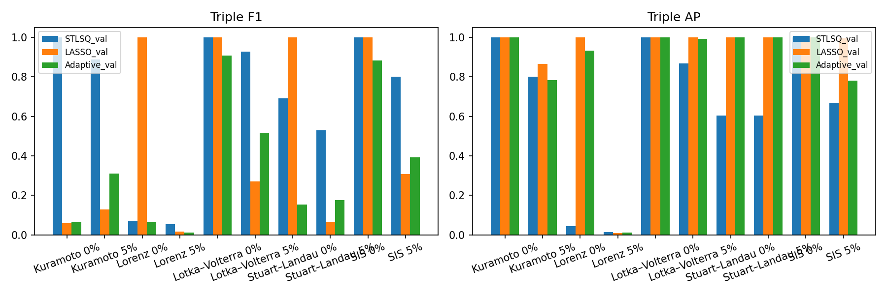

# V2 coverage 实验报告

统一验证集MSE选参是为了公平比较三种回归方法，不保证得到结构恢复F1最优的模型。

模型记录：30；状态：{'OK': 30, 'NA': 0, 'FAILED': 0}。运行时间：1086.58秒。
进程树RSS峰值（共享页重复计数的保守估计）：6216.5 MiB；最多进程数：16。
每个worker的高水位RSS和CPU/墙钟耗时见resources.csv。BLAS=1，并发worker数为8。

数据为独立t=0初始状态与解析导数，不是真实观测时间序列；全三阶Taylor库，无结构筛选。
三种算法共享训练均值/RMS标准化、自由截距和训练/验证数据。STLSQ仅搜索12档硬阈值，固定Ridge=1。
噪声仅加在解析导数，尺度由训练响应估计；测试NMSE对照干净导数。
网络实现同时变化拓扑与边权；展开中心、固有参数不变。

原始指标与状态见trials.csv/model_manifest.csv；逐参数选择见selection_details.csv。
配对统计仅匹配相同网络、数据、噪声；置信区间重采样独立网络，网络数少于2不生成区间。
between_network_mean_sd和within_network_rms_sd是描述性波动，不是分离后的纯拓扑方差分量。
只有10个独立网络时区间仍可能不稳定；不得把30组数据或候选边当成30个独立网络。

[三体表](tables/table1_threebody.md) · [二体表](tables/table2_pairwise.md)

FULL EXPERIMENT NOT RUN：本目录不能代替正式900模型结果。
