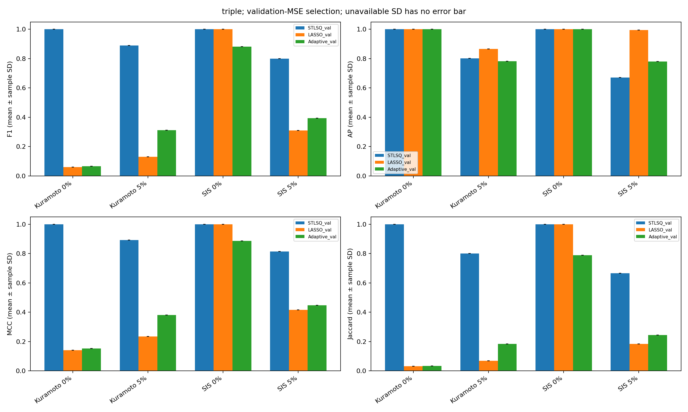
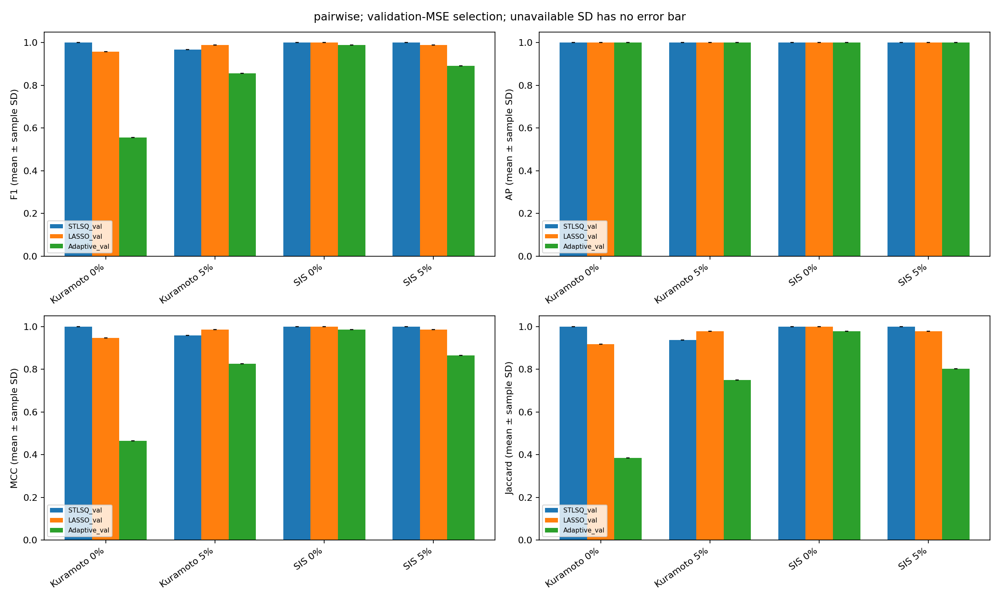
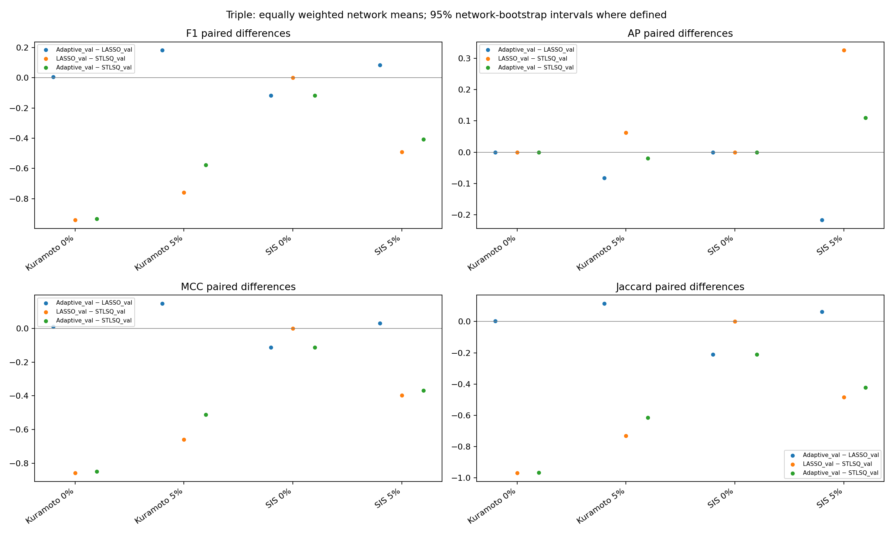
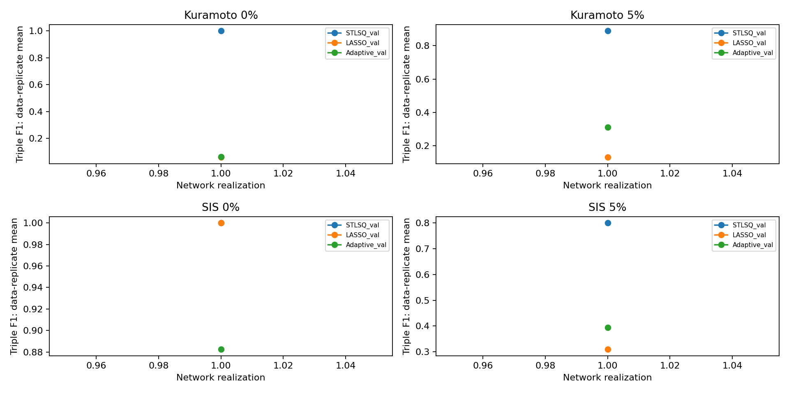

# V2统计分析：小规模验证

独立网络实现数：1；数据重复数：1。
统一验证集MSE选择是为了公平预测比较，不保证结构F1最优。
NA/FAILED不填0；先按完整网络计算指标，再按有效实例汇总，标准差ddof=1。
配对比较匹配同一网络、数据种子及噪声；bootstrap重采样网络均值，网络等权。有效配对不足或某指标未定义时单独报告数量和原因。
网络同时包含拓扑与边权随机性，网络间/网络内波动仅为描述统计，不能当作纯拓扑因果效应。
正式设计只有10个独立网络，置信区间仍可能不稳定；当前若只有1个网络，则所有网络bootstrap区间为NA。

[三体表](tables/table1_threebody.md) · [二体表](tables/table2_pairwise.md) · [配对差异](paired_summary.csv) · [波动统计](stability.csv)

均值图的误差条仅在样本标准差有定义时显示；n=1缺少误差条不代表方差为0。
FULL EXPERIMENT NOT RUN
