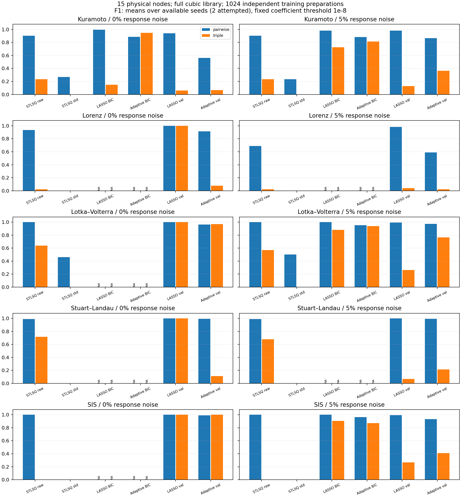
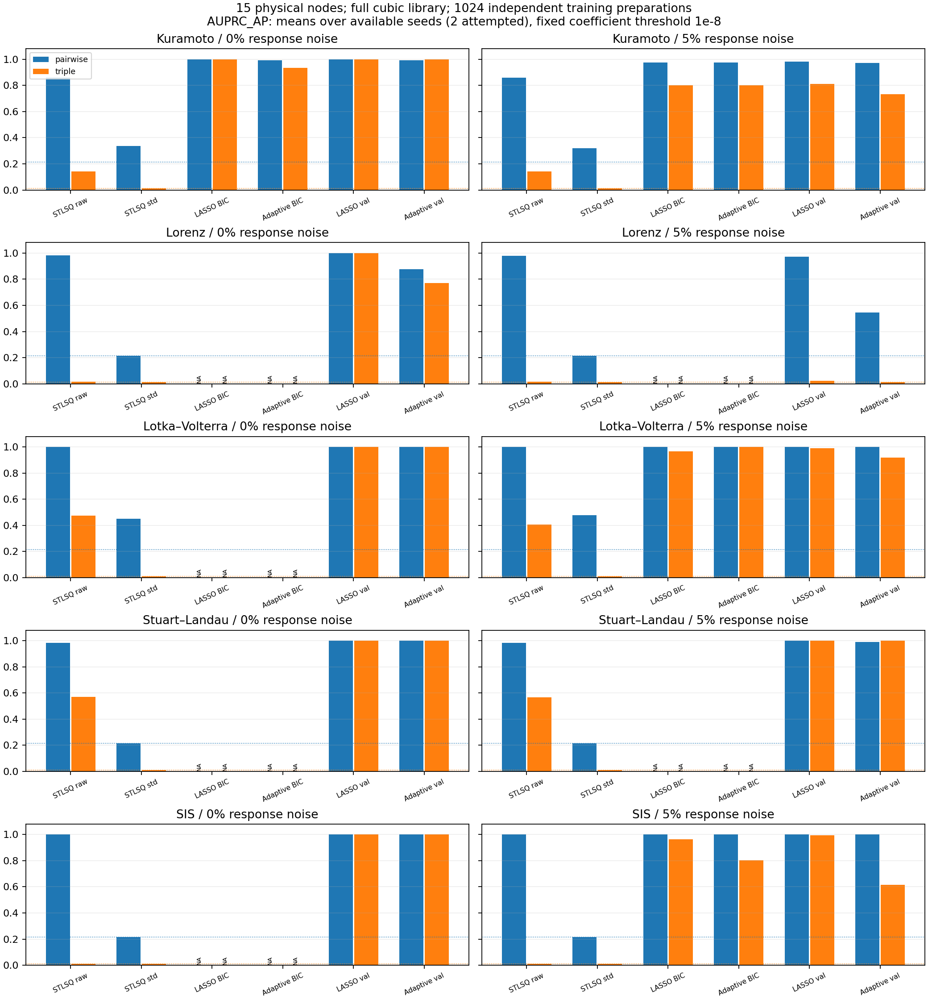

# 15节点、五类高阶动力学实验

已完成120个模型：96 OK、24 NA、0 FAILED；独立核验PASS。每系统2个种子，不作总体优越性或显著性结论。

五类模型为Kuramoto、Lorenz、高阶Lotka–Volterra、Stuart–Landau和SIS。每类15物理节点，相同45条有向成对边、15条三体边。三体目标—源二体面均存在。SL每节点2坐标，Lorenz每节点3坐标；其余每节点1变量。GLV为竞争性生态方程，SL为共轭坐标耦合，SIS为确定性节点概率闭合。具体方程、来源和稀疏有向改编边界见[预声明](../../../docs/dynamics15_five_systems_protocol.md)。

## 数据和函数库

每seed1024/256/256个训练/验证/测试独立初值，每个只取t=0状态及解析导数。此为局部瞬时向量场辨识，未使用长期轨迹、有限差分或真实观测。每坐标围绕固定非零中心独立均匀取值；GLV为正丰度，SIS概率在(0,1)。噪声为0%/5%导数响应高斯噪声，标准差仅由训练干净导数估计，分割流独立、方法共享。没有状态或传播过程噪声。

完整原生THIS三阶库，无Pearson、已知耦合通道或真实边筛选。所有真实方程源集合均保留；这由解析真系数的结构读出核对，不将真系数交给拟合。下表Taylor误差是解析系数的诊断结果，不是模型拟合成绩。

| 系统 | 物理节点 | 状态维度 | 完整库P | 训练K | 解析Taylor测试NMSE范围 |
| --- | ---: | ---: | ---: | ---: | ---: |
| Kuramoto | 15 | 15 | 816 | 1024 | 3.1e-06–3.55e-06 |
| Lorenz | 15 | 45 | 17296 | 1024 | 2.45e-32–2.47e-32 |
| Lotka–Volterra | 15 | 15 | 816 | 1024 | 3.33e-32–3.42e-32 |
| Stuart–Landau | 15 | 30 | 5456 | 1024 | 5.2e-32–5.21e-32 |
| SIS | 15 | 15 | 816 | 1024 | 5.23e-32–5.24e-32 |

相较30节点轮，本轮同时调整节点数、独立样本量、采样方式并取消Pearson硬筛选；成对/三体每目标入度保持3/1，所以候选边密度也提高。结果改善或退化不能全部归因于节点数。

## 方法与指标

STLSQ raw/std为原算法代数的primal/dual线性求解变体，λ=.1、ρ=1、10次；常数惩罚及停止规则保持。普通/Adaptive BIC调用原求解器，要求有效全模型噪声方差；K<=P或零噪声精确多项式使其NA是适用性限制。M1vC/M3C为普通/Adaptive完整库验证选择，所有40个模型统一采用LARS加速、全部12个原alpha点逐一检查全库KKT，不通过即回退原工作集求解。均匀缩放求解坐标和alpha只改善数值范围，不改变原单位目标。最多5000个LARS折点，回退保留原100000次CD上限；无固定删候选。所有方法按训练数据统一标准化，恢复原单位后结构解码。

STLSQ目前使用固定默认阈值，未获得与LASSO同等的验证参数搜索；raw/std使用同一数值阈值也不代表同一原单位剪枝强度。比较可描述这组具体流程，不足以证明LASSO普遍优于经过充分调参的STLSQ。

下表只平均OK种子，显示OK/2；NA/FAILED不当零。F1固定abs(coef)>1e-8；AP使用全部210个二体、1365个三体物理候选。预测NMSE对照干净测试导数，低预测误差不等于结构恢复成功。

15节点下正例比例提高：二体45/210≈0.2143，三体15/1365≈0.0110，也是常数得分的AP基线（图中点线）。30节点轮的对应基线为0.1034/0.00246，跨节点数比较AP应考虑此差异。

评价范围限定为二体和三体。完整三次多项式库也允许目标以外三个不同物理源的乘积，对应四体候选；这些项可以参与回归，但未计入本表二/三体F1，不能把本表解释为全部阶次结构的准确率。

| 系统 | 噪声 | 方法 | OK/2 | 二体F1/AP | 三体F1/AP | 测试NMSE |
| --- | ---: | --- | ---: | ---: | ---: | ---: |
| Kuramoto | 0% | STLSQ raw | 2/2 | 0.9024/0.8603 | 0.2353/0.1429 | 0.000961 |
| Kuramoto | 0% | STLSQ std | 2/2 | 0.2692/0.3365 | 0.0000/0.0110 | 0.0157 |
| Kuramoto | 0% | LASSO BIC | 2/2 | 0.9945/1.0000 | 0.1493/1.0000 | 4.79e-07 |
| Kuramoto | 0% | Adaptive BIC | 2/2 | 0.8859/0.9913 | 0.9494/0.9341 | 1.97e-06 |
| Kuramoto | 0% | LASSO val | 2/2 | 0.9424/1.0000 | 0.0616/1.0000 | 4.55e-07 |
| Kuramoto | 0% | Adaptive val | 2/2 | 0.5618/0.9913 | 0.0673/1.0000 | 5.11e-07 |
| Kuramoto | 5% | STLSQ raw | 2/2 | 0.9024/0.8603 | 0.2353/0.1429 | 0.000967 |
| Kuramoto | 5% | STLSQ std | 2/2 | 0.2326/0.3190 | 0.0000/0.0110 | 0.0169 |
| Kuramoto | 5% | LASSO BIC | 2/2 | 0.9830/0.9738 | 0.7273/0.8022 | 4.15e-05 |
| Kuramoto | 5% | Adaptive BIC | 2/2 | 0.8832/0.9736 | 0.8138/0.7996 | 2.33e-05 |
| Kuramoto | 5% | LASSO val | 2/2 | 0.9833/0.9825 | 0.1291/0.8104 | 3.31e-05 |
| Kuramoto | 5% | Adaptive val | 2/2 | 0.8660/0.9729 | 0.3647/0.7337 | 3.29e-05 |
| Lorenz | 0% | STLSQ raw | 2/2 | 0.9362/0.9825 | 0.0217/0.0168 | 0.000164 |
| Lorenz | 0% | STLSQ std | 2/2 | 0.0000/0.2143 | 0.0000/0.0110 | 0.0192 |
| Lorenz | 0% | LASSO BIC | 0/2 | NA | NA | NA |
| Lorenz | 0% | Adaptive BIC | 0/2 | NA | NA | NA |
| Lorenz | 0% | LASSO val | 2/2 | 1.0000/1.0000 | 1.0000/1.0000 | 3.36e-17 |
| Lorenz | 0% | Adaptive val | 2/2 | 0.9157/0.8778 | 0.0784/0.7716 | 7.1e-07 |
| Lorenz | 5% | STLSQ raw | 2/2 | 0.6902/0.9806 | 0.0218/0.0155 | 0.000234 |
| Lorenz | 5% | STLSQ std | 2/2 | 0.0000/0.2143 | 0.0000/0.0110 | 0.0192 |
| Lorenz | 5% | LASSO BIC | 0/2 | NA | NA | NA |
| Lorenz | 5% | Adaptive BIC | 0/2 | NA | NA | NA |
| Lorenz | 5% | LASSO val | 2/2 | 0.9830/0.9738 | 0.0385/0.0232 | 2.15e-05 |
| Lorenz | 5% | Adaptive val | 2/2 | 0.5907/0.5460 | 0.0236/0.0114 | 3.32e-05 |
| Lotka–Volterra | 0% | STLSQ raw | 2/2 | 1.0000/1.0000 | 0.6364/0.4725 | 0.000305 |
| Lotka–Volterra | 0% | STLSQ std | 2/2 | 0.4614/0.4500 | 0.0000/0.0110 | 0.00696 |
| Lotka–Volterra | 0% | LASSO BIC | 0/2 | NA | NA | NA |
| Lotka–Volterra | 0% | Adaptive BIC | 0/2 | NA | NA | NA |
| Lotka–Volterra | 0% | LASSO val | 2/2 | 1.0000/1.0000 | 1.0000/1.0000 | 7.83e-17 |
| Lotka–Volterra | 0% | Adaptive val | 2/2 | 0.9626/1.0000 | 0.9677/1.0000 | 4.47e-09 |
| Lotka–Volterra | 5% | STLSQ raw | 2/2 | 1.0000/1.0000 | 0.5714/0.4066 | 0.000305 |
| Lotka–Volterra | 5% | STLSQ std | 2/2 | 0.5000/0.4762 | 0.0000/0.0110 | 0.00652 |
| Lotka–Volterra | 5% | LASSO BIC | 2/2 | 1.0000/1.0000 | 0.8802/0.9670 | 2.19e-05 |
| Lotka–Volterra | 5% | Adaptive BIC | 2/2 | 0.9526/1.0000 | 0.9384/1.0000 | 5.1e-06 |
| Lotka–Volterra | 5% | LASSO val | 2/2 | 0.9945/1.0000 | 0.2619/0.9894 | 1.43e-05 |
| Lotka–Volterra | 5% | Adaptive val | 2/2 | 0.9730/1.0000 | 0.7643/0.9194 | 9.19e-06 |
| Stuart–Landau | 0% | STLSQ raw | 2/2 | 0.9888/0.9825 | 0.7182/0.5714 | 0.00139 |
| Stuart–Landau | 0% | STLSQ std | 2/2 | 0.0000/0.2143 | 0.0000/0.0110 | 0.137 |
| Stuart–Landau | 0% | LASSO BIC | 0/2 | NA | NA | NA |
| Stuart–Landau | 0% | Adaptive BIC | 0/2 | NA | NA | NA |
| Stuart–Landau | 0% | LASSO val | 2/2 | 1.0000/1.0000 | 1.0000/1.0000 | 1.15e-16 |
| Stuart–Landau | 0% | Adaptive val | 2/2 | 0.9945/1.0000 | 0.1112/1.0000 | 1.14e-06 |
| Stuart–Landau | 5% | STLSQ raw | 2/2 | 0.9888/0.9825 | 0.6800/0.5681 | 0.0014 |
| Stuart–Landau | 5% | STLSQ std | 2/2 | 0.0000/0.2143 | 0.0000/0.0110 | 0.137 |
| Stuart–Landau | 5% | LASSO BIC | 0/2 | NA | NA | NA |
| Stuart–Landau | 5% | Adaptive BIC | 0/2 | NA | NA | NA |
| Stuart–Landau | 5% | LASSO val | 2/2 | 1.0000/1.0000 | 0.0683/1.0000 | 5.1e-05 |
| Stuart–Landau | 5% | Adaptive val | 2/2 | 0.9944/0.9913 | 0.2151/1.0000 | 5.34e-05 |
| SIS | 0% | STLSQ raw | 2/2 | 1.0000/1.0000 | 0.0000/0.0110 | 0.0128 |
| SIS | 0% | STLSQ std | 2/2 | 0.0000/0.2143 | 0.0000/0.0110 | 0.0593 |
| SIS | 0% | LASSO BIC | 0/2 | NA | NA | NA |
| SIS | 0% | Adaptive BIC | 0/2 | NA | NA | NA |
| SIS | 0% | LASSO val | 2/2 | 1.0000/1.0000 | 1.0000/1.0000 | 6.38e-16 |
| SIS | 0% | Adaptive val | 2/2 | 0.9891/1.0000 | 1.0000/1.0000 | 1.81e-11 |
| SIS | 5% | STLSQ raw | 2/2 | 1.0000/1.0000 | 0.0000/0.0110 | 0.0128 |
| SIS | 5% | STLSQ std | 2/2 | 0.0000/0.2143 | 0.0000/0.0110 | 0.0593 |
| SIS | 5% | LASSO BIC | 2/2 | 1.0000/1.0000 | 0.9062/0.9627 | 0.000182 |
| SIS | 5% | Adaptive BIC | 2/2 | 0.9628/1.0000 | 0.8714/0.8022 | 5.73e-05 |
| SIS | 5% | LASSO val | 2/2 | 0.9945/1.0000 | 0.2660/0.9940 | 0.000115 |
| SIS | 5% | Adaptive val | 2/2 | 0.9333/1.0000 | 0.4118/0.6155 | 9.85e-05 |





## 完整性与可复现性

40项新Julia方程/契约测试、48项正式数据生成断言及116项Python测试通过（含5项LARS一致性/全库证书测试）。全部15734条接受模型结构边通过Julia原生解码与Python精确比较；另独立检查960个验证选参方程的全库KKT。15,360个初值RNG命名不重复，分割不重叠，训练标准化及响应噪声重算精确。原S6交付25368项、R5、小规模试跑及30节点正式轮6427项哈希保护通过。

模型状态和系数在真值/测试评分前统一锁定。任一方程FAILED则整个模型FAILED；无FAILED但有NA则整个模型NA，可用节点单独保存。失败诊断见[node_failure_reasons.csv](node_failure_reasons.csv)及各模型目录，无法评分不意味着零F1。

初始工作集版本因极低alpha路径耗时长，在任何真值/测试评分前停止，其部分结果、失败及日志冻结保存。本轮另建目录、重新生成相同seed数据并重新拟合全部120个模型，40个验证模型统一数值策略，避免混用两种求解精度。未按原轮失败状态选择性重试，也未读取结构真值/测试来调整加速器；[加速记录](execution_accelerator.json)可追溯。

验证方程中926个直接通过LARS证书，34个在回退后通过；逐系统/方法计数见[数值后端计数](solver_backend_counts.csv)。两次数据生成的全部10份原始CSV哈希一致。

[逐模型指标](trials.csv)、[汇总](summary.csv)、[全候选得分](edge_scores.csv)、[库与表达能力诊断](library_and_expression_audit.csv)、[锁定记录](selection_locked.json)、[独立校验](validation.json)、[完成状态](completion.json)、[文件清单](artifact_manifest.csv)。

```bash
PYTHONDONTWRITEBYTECODE=1 OPENBLAS_NUM_THREADS=1 .venv-r0/bin/python -B scripts/dynamics15_accelerated.py --label five_systems_certified_reproduce
PYTHONDONTWRITEBYTECODE=1 OPENBLAS_NUM_THREADS=1 .venv-r0/bin/python -B scripts/dynamics15_finish.py --label five_systems_certified_reproduce
```

## 本轮结果解读（审阅补充）

无噪声、独立验证选参时，普通LASSO在Lorenz、Lotka–Volterra、Stuart–Landau、SIS两种子上的二体和三体F1均为1。这里是解析导数、局部独立初值和固定合成图下的结果，不代表长期被动轨迹或实测数据。

真实源集合保留率已经达到100%，因此本轮低三体F1不能继续归因于Pearson漏边。Kuramoto无噪声普通验证LASSO三体AP=1、召回率=1，但精确率仅0.0318、F1=0.0616；Stuart–Landau无噪声Adaptive三体AP=1、召回率=1、F1=0.1112。这些组合的真边排名靠前，但固定1e-8支持阈值保留了大量假阳性。

Adaptive并未普遍胜过普通LASSO。5%噪声GLV三体F1由普通的0.2619提高至Adaptive的0.7643，同时AP由0.9894降至0.9194，说明指标反映的权衡不同。两种方法的原始连续分值、精确率和召回率均应保留，不能只挑有利指标。

Lorenz在5%响应噪声下，普通/Adaptive三体F1为0.0385/0.0236，AP为0.0232/0.0114，而三体AP基线约0.0110。这里还存在信号辨识及排序问题，不能将所有问题都归于固定支持阈值。具体机制需要另外的受控噪声、样本量和权重稳定性实验。

本轮同时改变了节点数、独立样本量、采样和候选策略；网络候选正例比例也提高。只能据此说明新配置下各流程的表现，不能将与30节点轮的差异全部归因于节点减少。当前测试真值未被用于选择新的支持阈值。

[审阅依据](review_findings.json)。
